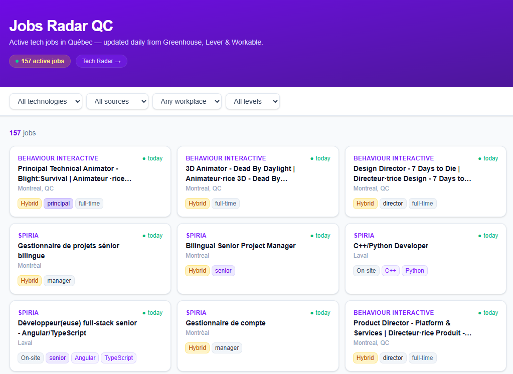
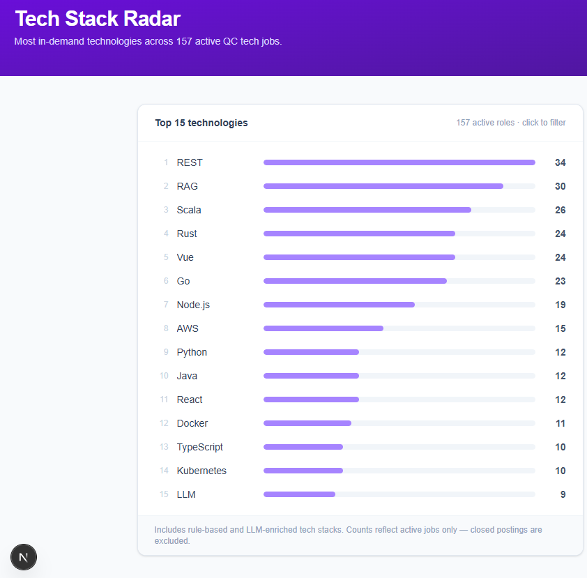
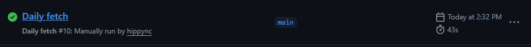

<p align="center">
  
</p>

<h1 align="center">Jobs Radar QC</h1>

<p align="center">
  <b>Every live tech job in Montreal and Quebec, straight from the company's own ATS, and the stack each one is hiring for.</b><br>
  51 companies · 4 ATS platforms · 123 tracked technologies · refreshed daily. No LinkedIn noise, no per-company scrapers.
</p>

<p align="center">
  <a href="https://github.com/hippync/jobs-radar-qc/actions/workflows/ci.yml"></a>
  <a href="https://github.com/hippync/jobs-radar-qc/actions/workflows/daily_fetch.yml"></a>
  <a href="https://github.com/hippync/jobs-radar-qc/actions/workflows/weekly_enrich.yml"></a>
  <a href="LICENSE"></a>
  
  
</p>

<p align="center">
  <a href="https://jobs-radar-qc.vercel.app"><b>Live app</b></a> ·
  <a href="https://jobs-radar-qc.vercel.app/trends"><b>Tech Stack Radar</b></a> ·
  <a href="docs/getting-started.md">Getting started</a> ·
  <a href="docs/architecture.md">Architecture</a>
</p>

<p align="center">
  <a href="https://jobs-radar-qc.vercel.app"></a>
</p>

---

## Highlights

- **Straight from the source.** Pulls open roles from Greenhouse, Lever, Workable and Workday, the systems companies actually post to. If it's on their ATS, it's real and it's open.
- **Filter by what you know.** Tech stack, seniority, remote, and 7 market segments (Mobile, FinTech, AI/ML, Cloud/Platform, Consulting, Enterprise, Startup SaaS).
- **[Tech Stack Radar](https://jobs-radar-qc.vercel.app/trends).** Which of 123 technologies appear most across active roles. Every bar links to the matching jobs.
- **Spec-driven, not scraper-driven.** Each ATS is three declarative files. Adding a company is one line of JSON.
- **Deterministic first, LLM second.** A daily rule-based pipeline that never calls a model, plus a weekly Claude Haiku pass for what regex misses. One can't break the other.
- **Track your search.** Save jobs to a Kanban board (watching → applied → interviewing) and save searches as alert rules, all in your browser.

## Quick start

**Just want the jobs?** Open **[jobs-radar-qc.vercel.app](https://jobs-radar-qc.vercel.app)**. Nothing to install.

**Want to run it yourself?** This fetches and extracts every Greenhouse company's openings, with no database or API keys:

```bash
git clone https://github.com/hippync/jobs-radar-qc.git && cd jobs-radar-qc
python -m venv .venv && source .venv/bin/activate && pip install -e ".[dev]"
python -m pipeline.extractor greenhouse
```

The full setup (database migrations, the frontend, enrichment and GitHub Actions) is in **[Getting started](docs/getting-started.md)**.

## Why this exists

Job hunting in Quebec tech means checking 50+ career pages every week. There's no single place to see who's hiring for Python, Go or .NET across Montreal startups and scale-ups, let alone which technologies are growing.

I'm a software engineering student, and I was spending 20–30 minutes a week checking a dozen career pages by hand to see what the market actually wanted. Not what LinkedIn says, with its sponsored posts and stale listings, but what's live on the companies' own ATS right now. Jobs Radar QC automates that, and the radar shows which technologies are growing without reading every posting.

## How it works

```
GitHub Actions ─► pipeline/ (daily) ─► Greenhouse · Lever · Workable · Workday
                                           │  specs/{ats}/*.xml, no LLM
                                           ▼
                          Supabase ◄── agents/enricher.py (weekly, Claude Haiku)
                                           │
                                           ▼
                          Next.js: job list · filters · /trends radar
```

1. **Every day,** a generic engine reads each ATS's spec, fetches every company's openings, and derives location, remote, seniority and tech stack with rule-based extraction. Non-tech roles are dropped, and closed roles are marked inactive.
2. **Every Sunday,** Claude Haiku reads the full descriptions and fills in technologies the rules missed, from a fixed [canonical list](core/canonical_tech_stack.json). Results are versioned by prompt hash, so changing the prompt re-enriches automatically.
3. **The frontend** merges both passes and renders the job list and radar server-side.

In production that's about 1M tokens a week, with a ~41% prompt cache hit rate (~$2/week saved). The design decisions and their tradeoffs are in **[Architecture](docs/architecture.md)**.

| Tech Stack Radar | Daily fetch on GitHub Actions |
|---|---|
|  |  |

## Coverage

| ATS | Companies | Examples |
|---|---|---|
| Greenhouse | 17 | Broadsign, AppDirect, Workleap, Lightspeed Commerce, Dialogue |
| Lever | 17 | Plusgrade, Mirego, Behaviour Interactive, Mistplay, Ludia |
| Workable | 9 | Tecsys, Nuvei, Genetec, GHGSat, Mila |
| Workday | 8 | Desjardins, Intact, CAE, Cogeco, Saputo |

Missing a company? If it uses one of these four, [adding it](docs/getting-started.md#adding-a-company) is one line in `specs/{ats}/schema.json`.

## Roadmap

- [x] ATS aggregation with stack, seniority and remote filters
- [x] Tech Stack Radar and role segments
- [x] Weekly LLM enrichment with prompt hash versioning
- [x] Saved jobs Kanban board and saved-search alert rules (in-browser)
- [ ] Resume upload and LLM job-fit scoring (built, not yet merged)
- [ ] Email/Slack delivery for alert rules
- [ ] 30-day trend deltas on the radar
- [ ] More ATS coverage: Ashby, BambooHR

## Contributing

Contributions are welcome, and the easiest one is a new company:

1. Check its ATS slug with the `curl` commands in [Getting started](docs/getting-started.md#adding-a-company).
2. Add `{ "name": "...", "slug": "..." }` to `specs/{ats}/schema.json`.
3. Run `python -m pipeline.extractor {ats}` and `pytest`, then open a PR.

For a new ATS, follow [Adding an ATS](docs/getting-started.md#adding-an-ats). Before changing extraction rules or the canonical tech list, read [Architecture](docs/architecture.md): a change to the canonical list re-enriches every job.

## Support

Found a wrong match, a missing company or a bug? [Open an issue](https://github.com/hippync/jobs-radar-qc/issues/new). For an extraction problem, include the job URL and the output of `python scripts/debug_extraction.py <url>`.

## License

[MIT](LICENSE)
