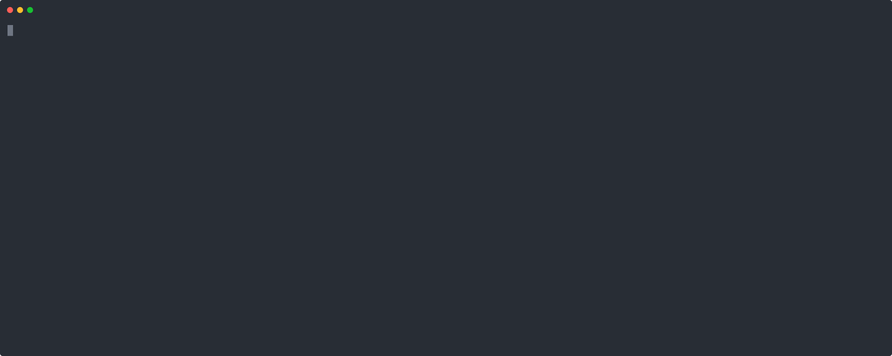

# Getting started

Run Jobs Radar QC locally, set up your own database, and add companies or ATS platforms. For how it works, see [Architecture](architecture.md).

---

## 1. Install

You need Python 3.11+ (CI runs 3.12), Node.js 20 and a Supabase project.

```bash
git clone https://github.com/hippync/jobs-radar-qc.git
cd jobs-radar-qc
python -m venv .venv && source .venv/bin/activate
pip install -e ".[dev]"
cp .env.example .env
```

Fill in `.env`:

| Variable | Needed for |
|---|---|
| `SUPABASE_URL`, `SUPABASE_SERVICE_ROLE_KEY` | The pipeline and enricher (writes) |
| `SUPABASE_ANON_KEY` | Read-only access |
| `ANTHROPIC_API_KEY` | The weekly enrichment agent only. The pipeline runs without it. |
| `ENRICHMENT_MODEL` | Optional; defaults to Claude Haiku |

For the frontend, copy the `NEXT_PUBLIC_*` variables from `.env.example` into `frontend/.env.local`.

## 2. Create the database

In the Supabase SQL editor, run these scripts in order:

| # | Script | Creates |
|---|---|---|
| 1 | [`migrate.sql`](../scripts/migrate.sql) | The `jobs` table, dedup constraint, GIN index on `tech_stack`, RLS (public read, service-role write) and the trigger that freezes `first_seen_at` |
| 2 | [`migrate_enrichment.sql`](../scripts/migrate_enrichment.sql) | The enrichment columns and the `active_qc_jobs` view |
| 3 | [`migrate_indexes.sql`](../scripts/migrate_indexes.sql) | Homepage query indexes. Uses `CREATE INDEX CONCURRENTLY`, so run each statement on its own |
| 4 | [`migrate_stats_rpc.sql`](../scripts/migrate_stats_rpc.sql) | `get_homepage_stats()`, used by the home page |
| 5 | [`migrate_contextual_facets_rpc.sql`](../scripts/migrate_contextual_facets_rpc.sql) | `get_contextual_facets()`, used by the filter counts |

## 3. Run it

```bash
# Run the full pipeline once
python -m pipeline.orchestrator

# Smoke-test a single ATS source
python -m pipeline.extractor greenhouse

# See how many jobs are waiting for enrichment (no API calls)
python -m agents.enricher --dry-run

# Run enrichment, capped at 50 jobs
python -m agents.enricher --limit 50

# Run the frontend → http://localhost:3000
cd frontend && npm install && npm run dev
```

In production, both jobs run on GitHub Actions: [`daily_fetch.yml`](../.github/workflows/daily_fetch.yml) every day at 12:17 UTC and [`weekly_enrich.yml`](../.github/workflows/weekly_enrich.yml) on Sundays at 13:00 UTC. They need the same secrets as `.env`.

## 4. Test and lint

```bash
pytest
pytest tests/test_lever_regression.py -v   # regression tests for extraction accuracy
ruff check . && mypy agents/ pipeline/ storage/ --ignore-missing-imports
```

CI runs these plus `pip-audit`, and `tsc`, `eslint` and `npm audit` on the frontend.

---

## Adding a company

Open `specs/{ats}/schema.json` and add an entry to the `companies` array:

```json
{ "name": "Your Company", "slug": "your-ats-slug" }
```

Check the slug first:

```bash
# Greenhouse
curl -s "https://boards-api.greenhouse.io/v1/boards/your-slug/jobs" | python3 -c "import sys,json; print(len(json.load(sys.stdin)['jobs']), 'jobs')"

# Lever
curl -s "https://api.lever.co/v0/postings/your-slug?mode=json" | python3 -c "import sys,json; print(len(json.load(sys.stdin)), 'jobs')"

# Workable
curl -s "https://apply.workable.com/your-slug/llms.txt" | grep "current opening"
```

No Python changes are needed.

## Adding an ATS

Create `specs/your-ats/` with the same three files as [`specs/greenhouse/`](../specs/greenhouse/) (`source.md`, `schema.json`, `extraction.xml`) and use those as the reference. The engine picks up new specs automatically on the next run.

## Debugging extraction

`scripts/debug_extraction.py` fetches one job and prints the evidence behind each detected technology:

```bash
python scripts/debug_extraction.py https://jobs.lever.co/company/job-id
```



To compare rule-based and LLM results before a production enrichment run, with no DB writes:

```bash
python scripts/test_enrichment.py
```
